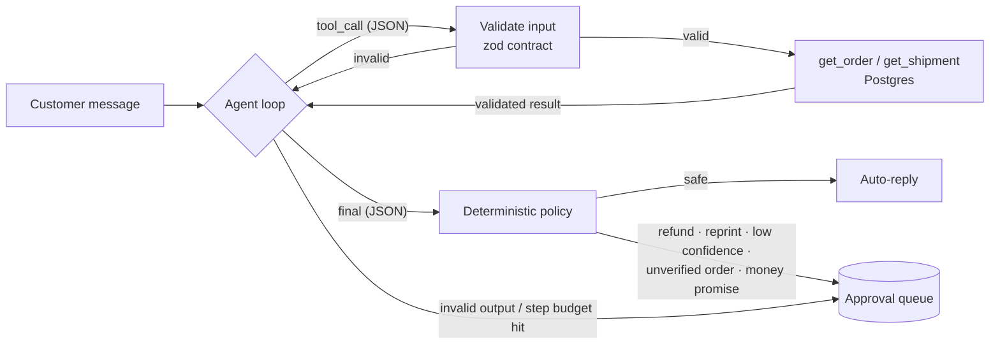

# support-triage-agent

An LLM agent that triages customer-support messages for an online custom-printing shop. It reads a message, looks up the order and shipment through **validated tool contracts**, drafts a reply, and decides whether the reply can go out on its own or must wait for a **human approval**.

The point of this project is not the model call. It's the engineering around it that makes an agent safe to run against real customers: strict tool contracts, retries, a deterministic policy layer the model can't talk its way past, structured traces, and an evaluation set that says where it fails.



## Design decisions

| Concern | How it's handled | Where |
|---|---|---|
| **Model can only act through defined tools** | Each tool has a zod input *and* output schema. A malformed call (e.g. `orderId: "1001; DROP TABLE"`) is rejected before it reaches the database and the error is fed back to the model. | `src/tools.ts` |
| **Model output is untrusted** | Every turn must parse as exactly one JSON action (`tool_call` or `final`). Anything else is rejected with the validation error, costing one step of a fixed budget. | `src/actions.ts`, `src/agent.ts` |
| **Money never moves on the model's say-so** | After the model decides, a plain-code policy holds the reply for a human if it proposes a refund/reprint/escalation, has confidence < 0.7, references an order it never looked up, or mentions money back without proposing a refund. | `src/policy.ts` |
| **Prompt injection** | Customer text is treated as data. Even if a message convinces the model, the policy layer still routes refunds to a human. Covered by eval cases `injection-*`. | `src/prompt.ts`, `eval/cases.json` |
| **Flaky providers** | LLM calls retry on 408/409/429/5xx and network errors with exponential backoff and jitter. Non-retryable errors fail fast. | `src/retry.ts`, `src/llm.ts` |
| **Nothing is silently dropped** | If the agent can't finish (provider down, step budget exhausted), the message is escalated to the approval queue with its trace id. | `src/agent.ts` |
| **Observability** | Every step (model turn, tool call, retry, policy decision) is a structured event with a shared trace id. `TRACE=1` streams them as JSON lines. | `src/tracer.ts` |
| **Provider-agnostic** | A small `LLMClient` interface with Anthropic and OpenAI implementations over plain `fetch`; the agent uses a JSON action protocol rather than one vendor's tool-calling format. | `src/llm.ts` |

## Run it

Requirements: Node 20+, Docker, and an Anthropic or OpenAI API key.

```bash
npm install
docker compose up -d --wait          # Postgres on :55432 with seed orders
cp .env.example .env                 # then add your API key to .env

npm run triage -- "Where is my order SM-1001?"
npm run approvals                    # see what's waiting for a human
npm run eval                         # run the 20-case evaluation, writes eval/results.md
```

Offline checks (no API key or database needed; uses a scripted fake model):

```bash
npm test           # agent loop, policy and tool-contract tests
npm run typecheck
```

## Evaluation

`eval/cases.json` holds 20 messages with expected outcomes: order status, shipping exceptions, artwork problems, refund and reprint requests, a missing order id, a non-existent order, an off-topic question, and two prompt-injection attempts. Each case is scored on independent checks (completed, category, routing to auto-reply vs. approval, tools used, key facts in the reply, forbidden phrases absent), so a failure says *what* went wrong rather than just "fail".

Results from the latest run are in [`eval/results.md`](eval/results.md).

## Project layout

```
src/
  agent.ts          agent loop: model turn -> validate -> tool or final -> policy
  actions.ts        JSON action schema the model must follow
  tools.ts          tool contracts (zod in/out) and the dispatcher
  policy.ts         deterministic approval rules
  llm.ts            Anthropic / OpenAI clients with retryable error classification
  retry.ts          exponential backoff with jitter
  tracer.ts         structured per-run trace events
  repo.ts           Postgres and in-memory repositories
  cli.ts            triage one message from the command line
  approvals-cli.ts  list the human approval queue
eval/               evaluation cases and runner
test/               offline tests with a scripted model
db/init.sql         schema and seed data
```

## What I'd add next

- An approve/reject command that sends the approved reply and records the reviewer's decision, so approval data can be used to tune the policy thresholds.
- Per-category confidence thresholds learned from that approval history.
- Token and latency budgets per run, reported in the trace.
- A larger eval set built from anonymised real tickets, run in CI against a pinned model.

Built by Adeel Muzaffar, with Claude Code as a pair-programming assistant.
